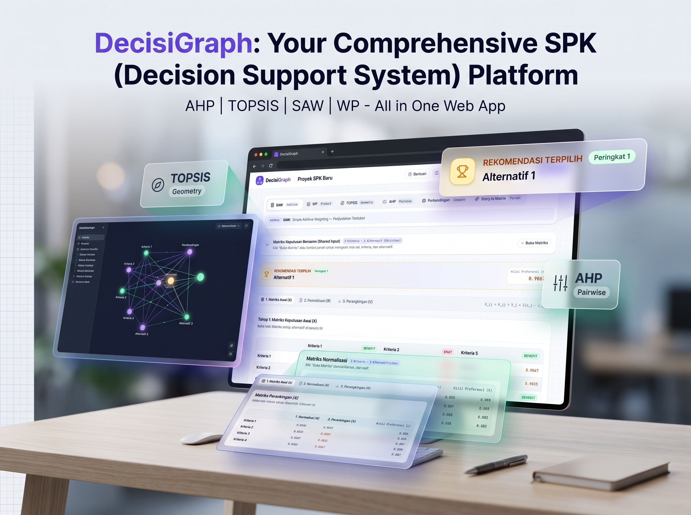

# 🧠 DecisiGraph

> **Platform Decision Intelligence & Sistem Pendukung Keputusan (SPK) Modern berbasis Web — Menggabungkan kalkulasi matematis multi-metode presisi, transparansi jejak perhitungan (*traceable & explainable*), dan kecerdasan Generative AI (Google Gemini).**

[](https://react.dev/)
[](https://www.typescriptlang.org/)
[](https://vitejs.dev/)
[](https://tailwindcss.com/)
[](https://ai.google.dev/)
[](https://vitest.dev/)
[](./LICENSE)
[](./package.json)

---



---

## 📌 Tentang Proyek

**DecisiGraph** adalah platform pengambilan keputusan multi-kriteria (*Multi-Criteria Decision Making / MCDM*) komprehensif yang dirancang untuk menjembatani kesenjangan antara teori matematis SPK yang kaku dan kebutuhan praktis di dunia nyata. 

Banyak pengambil keputusan, peneliti, dan mahasiswa menghadapi kendala klasik saat menyusun SPK:
1. Perhitungan manual di spreadsheet rawan kekeliruan formula dan sulit diaudit.
2. Hasil perankingan sering kali tidak bisa dijelaskan (*black-box*) kepada pemangku kepentingan (*stakeholders*).
3. Data kasus nyata umumnya terserak di dokumen narasi bebas, proposal Word/PDF, atau lembar Excel tanpa struktur matriks siap pakai.
4. Perubahan bobot kriteria tidak dapat diuji secara dinamis untuk mengetahui seberapa rentan rekomendasi akhir terhadap bias.

DecisiGraph menyelesaikan tantangan tersebut dengan menghadirkan:
- **Kalkulasi Matematis Transparan & Terverifikasi**: Traceability Inspector per sel untuk menelusuri rumus dan nilai asal.
- **Kecerdasan Buatan Terintegrasi (Google GenAI)**: Ekstraksi dokumen otomatis, konversi narasi bebas (*Story-to-Matrix*), dan sintesis manajerial dengan penalaran kausal.
- **Hub Evaluasi Keputusan Tingkat Lanjut**: Analisis sensitivitas interaktif, simulasi skenario *What-If*, *Goal Seeking* terbalik, dan analisis korelasi peringkat Spearman.
- **Pelaporan Eksekutif Otomatis**: Generator laporan multi-bab PDF profesional siap cetak yang dilengkapi langkah matematis LaTeX.

---

## ✨ Fitur Unggulan v1.1

### 1. 🧠 AI Decision Intelligence & Managerial Synthesis
- **Sintesis Manajerial Berpenalaran Kausal**: AI tidak hanya menyebutkan siapa pemenang keputusan, melainkan membedah *mengapa* alternatif tersebut unggul secara struktural, menguraikan kelemahan kriteria yang perlu dimitigasi, serta mengeksplorasi trade-off strategis.
- **Rekomendasi Bertingkat Peran (*Role-Based Recommendations*)**: Menghasilkan rekomendasi aksi operasional yang disesuaikan untuk empat peran pemangku kepentingan:
  - 👔 *Executive / Decision Maker*: Kebijakan strategis dan alokasi anggaran.
  - ⚙️ *Operational Lead*: Eksekusi lapangan dan alur kerja harian.
  - 🛠️ *Technical Specialist*: Spesifikasi teknis, integrasi sistem, dan SLA.
  - 📋 *Risk & Compliance Auditor*: Pengawasan regulasi, audit kelayakan, dan mitigasi risiko.
- **Multi-Model Engine & Resiliensi Tinggi**: Mengoptimalkan orkestrasi model Google Gemini generasi cepat (`gemini-2.5-flash`, `gemini-2.5-flash-lite`, `gemini-3.5-flash-lite`, `gemini-3.6-flash`) dengan batas waktu respons ketat (*timeout 8 detik*).
- **100% Deterministic Fallback Engine**: Jika koneksi offline atau kuota API tercapai, sistem secara otomatis beralih ke analisis logika berbasis aturan (*rule-based*) deterministik tanpa menghentikan alur kerja pengguna.
- **Smart AI Caching**: Caching cerdas di sisi klien untuk mencegah permintaan berulang yang boros kuota, lengkap dengan tombol regenerasi saat diperlukan.

### 2. 🔬 Decision Analysis & Evaluation Hub (Tab Evaluasi)
- **Interactive Weight Sensitivity Analysis**: Slider dinamis untuk menguji dampak fluktuasi bobot kriteria terhadap stabilitas peringkat juara secara real-time.
- **Goal Seeking (Analisis Terbalik)**: Algoritma invers matematis yang menghitung peningkatan performa minimum yang harus dicapai alternatif non-juara (*runner-up*) untuk dapat menggeser posisi peringkat 1.
- **What-If Scenario Simulator**: Simulasikan modifikasi nilai atribut alternatif untuk mengevaluasi skenario masa depan sebelum komitmen sumber daya dilakukan.
- **Trade-Off & Cost vs Benefit Explorer**: Visualisasi kuadran efisiensi yang memisahkan kriteria biaya (*Cost*) terhadap keuntungan (*Benefit*) guna mengidentifikasi kandidat yang paling optimal dari segi rasio manfaat-biaya (*cost-efficiency*).
- **Uji Korelasi Spearman's Rho**: Mengukur kekuatan konsistensi peringkat antar skenario simulasi.

### 3. 📄 AI Document Loader (PDF, DOCX, XLSX, TXT)
- **Ekstraksi Otomatis Dokumen Nyata**: Unggah berkas dokumen proposal, Term of Reference (TOR/KAK), atau spesifikasi pengadaan. Sistem langsung mengekstrak metadata studi kasus, nama organisasi, pagu anggaran, kriteria benefit/cost, bobot, dan matriks nilai alternatif.
- **Preview & Verification Dialog**: Dialog peninjauan interaktif untuk memeriksa dan menyunting matriks hasil ekstraksi AI sebelum diimpor ke matriks utama.
- **Dukungan Format Luas**: Didukung engine ekstraksi `mammoth` (Word/DOCX), `xlsx` (Excel), `pdfjs-dist` (PDF), dan pemroses teks murni.

### 4. 🔄 Story-to-Matrix Parser V1.1 (Dual Mode)
- **Mode Narasi Bebas (AI Extractor)**: Membaca teks studi kasus naratif bebas berbahasa Indonesia dan mengekstrak tabel keputusan lengkap tanpa perlu mengikuti format baku.
- **Mode Format Standar (Regex Parser)**: Parsing instan super cepat untuk format teks terstruktur.
- **Auto-Cleanup & Project Reset Sync**: Terintegrasi penuh dengan siklus hidup proyek; input cerita otomatis dibersihkan saat proyek di-reset dan tersinkronisasi dua arah.

### 5. 📊 Multi-Method Comparison & Consensus Insight
- **Komparasi 4 Metode Berdampingan**: Menampilkan ranking dari metode SAW, WP, TOPSIS, dan pembobotan AHP dalam satu tabel terpadu.
- **Dynamic Method Selector**: Pilih kombinasi metode yang ingin disertakan dalam komparasi.
- **Peringkat Rata-Rata Adaptif & Deteksi Konsensus**: Menghitung konsensus peringkat lintas metode untuk mereduksi bias dari satu formula algoritma tertentu.
- **Indikator Pergeseran Peringkat (*Rank Shift Badges*)**: Visualisasi badge dinamika perubahan peringkat (+/-) terhadap metode acuan dasar.
- **Audit Konsistensi AHP (Saaty)**: Evaluasi matriks perbandingan berpasangan, nilai Eigen maksimum ($\lambda_{max}$), indeks konsistensi (CI), dan Rasio Konsistensi (*Consistency Ratio / CR*) dengan panduan ambang batas $CR \le 0.1$.

### 6. 📑 Dynamic Multi-Method PDF Executive Report
- **Laporan Komprehensif Siap Cetak**:
  - Bab 1: Ringkasan Eksekutif & Narasi Manajerial AI.
  - Bab 2: Rekomendasi Aksi Pemangku Kepentingan (Leader, Operator, Tech, Audit).
  - Bab 3: Spesifikasi Kasus, Konteks Organisasi, dan Pagu Anggaran.
  - Bab 4: Matriks Keputusan Awal & Pembobotan Kriteria.
  - Bab 5: Pembuktian Matematis per Metode (Formula LaTeX & Tabel Normalisasi SAW, WP, TOPSIS, AHP).
  - Bab 6: Analisis Komparasi Konsensus & Kesimpulan Akhir.
- **Desain Tipografi Kontras Tinggi**: Menggunakan `@react-pdf/renderer` dengan tata letak elegan, tabel berpaginasi rapi, formula matematis LaTeX, dan progress bar sinkronisasi tanpa elemen dekoratif berlebihan.

### 7. 💰 Standardisasi Nominal Mata Uang & Unit Kriteria
- **Format Rupiah Standar (`Rp ...`)**: Seluruh nominal angka di dalam narasi AI, tabel evaluasi, rekomendasi fallback, dan ekspor laporan PDF diformat secara konsisten mengikuti standar mata uang Indonesia (`Rp 2.500.000`).
- **Custom Criterion Unit Presets**: Pilihan unit kriteria yang kaya (Rp, $, %, thn, bln, unit, poin, dll.) dengan antarmuka selectbox yang *searchable* dan *creatable*.

### 8. 💾 Universal Project Backup & Restore
- **Sinkronisasi JSON Global**: Ekspor dan impor seluruh status proyek (matriks bersama, matriks perbandingan AHP, hasil evaluasi, input narasi, dan preferensi) ke berkas `.json` atau melalui *clipboard*.
- **Akses Mudah di Header**: Tersemat pada navigasi atas untuk kemudahan transfer proyek antar perangkat.

### 9. 🌐 Ekosistem Komunitas & Layanan Pendukung
- **Community Board & Reviews**: Ulasan pengguna secara real-time yang terhubung ke Firebase Realtime Database dengan rating bintang interaktif dan pemfilteran peran profesi.
- **In-App Bug Reporter Terintegrasi**: Kirim laporan kendala teknis dan bukti tangkapan layar langsung ke email pengembang tanpa membuka aplikasi mail client (didukung Web3Forms API dengan proteksi bot honeypot, cooldown 60 detik, batas kuota, dan sanitasi anti-XSS).
- **Transparansi Web Analytics**: Pantau statistik kunjungan situs (harian, bulanan, tahunan, perangkat, dan browser) dengan deduplikasi akurat dan sistem *garbage collection* otomatis.
- **Clean URL Routing**: Navigasi mulus dengan URL modern: `/` (Workboard), `/board` (Komunitas), `/reviews` (Ulasan), dan `/analytics` (Statistik).

---

## 🔢 Metode MCDM yang Didukung

| Metode | Karakteristik Utama | Formula Inti |
| :--- | :--- | :--- |
| **SAW**<br>*(Simple Additive Weighting)* | Penjumlahan linier terbobot dari matriks yang dinormalisasi. Sangat intuitif dan transparan. | $V_i = \sum_{j=1}^{n} w_j r_{ij}$ |
| **WP**<br>*(Weighted Product)* | Perkalian berpangkat di mana bobot kriteria bertindak sebagai eksponen. Ketat terhadap nilai ekstrim rendah. | $S_i = \prod_{j=1}^{n} x_{ij}^{w_j}, \quad V_i = \frac{S_i}{\sum S_k}$ |
| **TOPSIS**<br>*(Ideal Solution Similarity)* | Mengukur jarak Euclidean terhadap Solusi Ideal Positif ($A^+$) dan Solusi Ideal Negatif ($A^-$). | $C_i = \frac{D_i^-}{D_i^+ + D_i^-}$ |
| **AHP**<br>*(Analytic Hierarchy Process)* | Pembobotan hierarkis berbasis perbandingan berpasangan Saaty (skala 1–9) dengan uji rasio konsistensi ($CR$). | $A \cdot w = \lambda_{max} \cdot w, \quad CR = \frac{CI}{RI}$ |

---

## 🗺️ Roadmap Pengembangan

DecisiGraph terus berevolusi secara terarah dari kalkulator lokal menuju ekosistem *Decision Intelligence* yang tangguh.

### ✅ v1.0 — *Foundation (MVP)*
- [x] Implementasi engine kalkulasi dasar: SAW, WP, TOPSIS, dan pembobotan AHP.
- [x] Traceability Inspector untuk audit kalkulasi matematis per sel.
- [x] Matriks keputusan bersama (*Shared Decision Matrix*) reaktif.
- [x] Ekspor laporan PDF awal.
- [x] Glosarium interaktif dan tur panduan pengguna (*Interactive Tour*).

### ✅ v1.1 — *AI Decision Intelligence, Evaluation Hub & Ecosystem* · **(Rilis Saat Ini)**
- [x] **AI Decision Intelligence**: Sintesis manajerial berbasis penalaran kausal, analisis trade-off, dan rekomendasi bertingkat peran (*Leader, Operator, Tech, Audit*).
- [x] **Decision Evaluation Hub**: Analisis sensitivitas interaktif, simulasi skenario *What-If*, *Goal Seeking* terbalik, dan analisis korelasi Spearman's Rho.
- [x] **AI Document Loader**: Unggah dan ekstraksi otomatis berkas PDF, Word (DOCX), Excel (XLSX), dan TXT ke matriks SPK terstandarisasi.
- [x] **Story-to-Matrix V1.1**: Mode narasi bebas AI dan mode regex standar terstruktur dengan sinkronisasi reset proyek.
- [x] **Standardisasi Nominal Rupiah**: Sanitasi dan format otomatis `Rp ...` di seluruh teks narasi AI, tabel normalisasi, dan laporan.
- [x] **Optimasi Model AI**: Integrasi `@google/genai` dengan Gemini 2.5/3.x Flash, strict timeout 8 detik, dan 100% deterministic fallback.
- [x] **Laporan Eksekutif PDF Komprehensif**: Format multi-bab formal dengan formula matematika LaTeX dan tabel langkah per metode.
- [x] **Universal Project Backup & Restore**: Impor/ekspor JSON proyek lengkap dan clipboard sync.
- [x] **Pengayaan Unit Kriteria**: Presets unit kustom dengan input selectbox yang *searchable* dan *creatable*.
- [x] **Community Board, Bug Reporter & Analytics**: Ekosistem ulasan Firebase, formulir pelaporan kendala anti-spam Web3Forms, dan pelacakan analitik transparan.
- [x] **Developer Quality Tooling**: Script pembersih & auditor komentar berbasis TypeScript AST (`npm run comments:check` / `clean`) dan 138 unit tests lulus.

### 🌐 v2.0 — *SPK Modular Engine Architecture & Cloud Persistence*
- [ ] **Pemisahan Konseptual Engine**: Arsitektur modular yang memisahkan *Weighting Engines* (AHP, Entropy, Rank Order Centroid / ROC, Manual) dari *Ranking Engines* (SAW, WP, TOPSIS, MOORA, WASPAS).
- [ ] **Cloud Persistence & Google OAuth**: Masuk tanpa kata sandi dan simpan riwayat proyek multi-keputusan secara persisten di cloud.
- [ ] **Manajemen Kolaborasi Proyek**: Berbagi tautan proyek keputusan untuk ditinjau bersama oleh tim secara daring.

### 🚀 v3.0 — *Advanced Decision Methods & Enterprise Suite*
- [ ] **Metode Lanjutan**: ANP *(Analytic Network Process)*, PROMETHEE, VIKOR, COPRAS, dan EDAS.
- [ ] **Mode Gelap Penuh (*Full Dark Mode*)** dengan palet kontras tinggi.
- [ ] **Enterprise Audit Trail**: Ekspor berkas audit kepatuhan regulasi dan tanda tangan digital pada dokumen keputusan.

---

## 🧰 Tech Stack

| Lapisan / Kategori | Teknologi | Deskripsi |
| :--- | :--- | :--- |
| **Framework & Core** | React 18, TypeScript 5.5, Vite 5 | Fondasi antarmuka komponen modern dengan tipe data yang ketat dan proses build kilat. |
| **Styling & Design** | TailwindCSS v4 | Pendekatan CSS-first modern dengan `@theme` tokens dan optimasi rendering 60 FPS. |
| **AI & LLM Engine** | `@google/genai` (Google Gemini) | Orkestrasi model Gemini 2.5 / 3.x Flash untuk ekstraksi dokumen, konversi narasi, dan sintesis manajerial. |
| **Dokumen & Parser** | `pdfjs-dist`, `mammoth`, `xlsx` | Pemrosesan dan ekstraksi dokumen biner PDF, Word (DOCX), dan lembar kerja Excel di sisi klien. |
| **Kalkulasi Presisi** | `decimal.js` | Menjamin akurasi tinggi dan mengeliminasi masalah presisi floating-point pada kalkulasi SPK. |
| **Laporan PDF** | `@react-pdf/renderer`, `katex` | Pembuatan dokumen PDF dinamis multi-bab dengan formula matematika bergaya LaTeX. |
| **State Management** | Zustand + Immer | Manajemen state global terpusat yang reaktif, ringan, dan mendukung immutability. |
| **Komponen & Visual** | Recharts, Lucide React, Framer Motion | Grafik radar sensitivitas, visualisasi trade-off, ikon modern, dan transisi mulus. |
| **Formulir & Validasi** | React Hook Form + Zod | Validasi skema input matriks, toleransi bobot, dan sanitasi payload. |
| **Layanan Cloud** | Firebase Realtime DB, Web3Forms | Penyimpanan ulasan komunitas, analitik kunjungan, dan pengiriman email laporan kendala otomatis. |
| **Pengujian (Testing)** | Vitest, Testing Library, jsdom | Suite pengujian otomatis yang mencakup 16 berkas pengujian dan 138 unit tests lulus. |

---

## 📁 Struktur Folder Proyek

```
decisigraph/
├── public/                      # Aset statis dan ilustrasi
├── scripts/                     # Tooling pengembang (AST comment manager, dll.)
├── src/
│   ├── App.tsx                  # Root aplikasi, layout, dan penyedia konteks
│   ├── app/                     # Definisi rute URL (Workboard, Board, Reviews, Analytics)
│   ├── components/              # Komponen antarmuka yang dapat digunakan kembali
│   │   ├── layout/              # AppShell, Navbar, Footer, ProjectBackupModal
│   │   └── ui/                  # Atom: Button, Card, Badge, Modal, Input, GaugeMeter
│   ├── core/                    # Logika bisnis murni (framework-agnostic)
│   │   ├── analysis/            # Engine evaluasi: Sensitivity, Goal Seeking, Trade-off, Spearman
│   │   ├── constants/           # Konstanta matematika (Tabel Rasio Indeks Saaty RI, dll.)
│   │   ├── math/                # Engine kalkulasi matematis: SAW, WP, TOPSIS, AHP, Compare
│   │   ├── parser/              # Parser teks terstruktur Story-to-Matrix (Regex)
│   │   └── tour/                # Definisi langkah tur interaktif per metode
│   ├── features/                # Modul fitur fungsional
│   │   ├── ahp/                 # Matriks perbandingan berpasangan AHP & Uji Konsistensi CR
│   │   ├── community/           # Community Board, linimasa diskusi & analitik pengunjung
│   │   ├── comparison/          # Komparasi lintas metode, konsensus, dan rank shift
│   │   ├── document-loader/     # AI Document Loader modal & ekstraktor dokumen PDF/DOCX/XLSX
│   │   ├── evaluation/          # Hub Evaluasi Keputusan, Analisis Sensitivitas & Sintesis AI
│   │   ├── export/              # Generator PDF multi-bab eksekutif & modal progress bar
│   │   ├── glossary/            # Glosarium istilah teknis SPK kontekstual
│   │   ├── inspector/           # Traceability Inspector jejak formula matematis per sel
│   │   ├── landing/             # Halaman pengantar, ilustrasi 2.5D SVG, dan panduan fitur
│   │   ├── project/             # Modal backup/restore proyek JSON & clipboard sync
│   │   ├── saw/                 # Tab kalkulasi dan tabel normalisasi SAW
│   │   ├── shared/              # Matriks keputusan bersama, CriteriaEditor, AlternativeEditor
│   │   ├── story-to-matrix/     # Input cerita studi kasus mode narasi bebas & standar
│   │   ├── topsis/              # Tab kalkulasi TOPSIS, matriks terbobot & jarak solusi ideal
│   │   ├── tour/                # TourRunner dan launcher panduan interaktif
│   │   ├── workboard/           # Papan kerja utama pengambil keputusan
│   │   └── wp/                  # Tab kalkulasi WP, vektor S, dan vektor preferensi V
│   ├── services/                # Integrasi layanan eksternal
│   │   ├── ai/                  # Client Gemini, cache cerdas, ekstraktor narasi, fallback engine
│   │   ├── firebase.ts          # Layanan interaksi Firebase Realtime DB & deduplikasi analitik
│   │   └── routePrefetch.ts     # Pre-fetching rute untuk transisi navigasi instan
│   ├── store/                   # Zustand stores (useProjectStore, useEvaluationStore, useTourStore)
│   ├── styles/                  # globals.css, Tailwind tokens, dan penataan KaTeX
│   ├── test/                    # Suite unit test komprehensif Vitest
│   ├── types/                   # Definisi tipe domain TypeScript
│   ├── utils/                   # Utilitas: format mata uang Rupiah, kalkulasi string, classNames
│   └── validators/              # Skema validasi Zod untuk integritas data
├── index.html
├── package.json
├── vite.config.ts
└── README.md
```

---

## 🚀 Panduan Memulai (*Getting Started*)

### Prasyarat Sistem

- **Node.js**: versi `18.0.0` atau lebih baru (direkomendasikan Node 20 LTS)
- **npm**: versi `9.0.0` atau lebih baru

### Langkah Instalasi

```bash
# 1. Klon repositori dari GitHub
git clone https://github.com/hafidzrdwn/decisigraph.git
cd decisigraph

# 2. Pasang seluruh dependensi proyek
npm install

# 3. Buat dan konfigurasikan berkas Environment Variables
cp .env.example .env
```

### Konfigurasi `.env`

Buka berkas `.env` dan sesuaikan kredensial berikut:

```env
# Google Gemini GenAI (Wajib untuk fitur AI: Story-to-Matrix Bebas, Document Loader, & Sintesis Narasi)
VITE_GEMINI_API_KEY=your_gemini_api_key_here

# Firebase Realtime Database & Analytics (Opsional: untuk Community Board & Web Analytics)
VITE_FIREBASE_API_KEY=your_firebase_api_key_here
VITE_FIREBASE_AUTH_DOMAIN=your_project.firebaseapp.com
VITE_FIREBASE_DATABASE_URL=https://your_project-default-rtdb.asia-southeast1.firebasedatabase.app
VITE_FIREBASE_PROJECT_ID=your_project_id
VITE_FIREBASE_STORAGE_BUCKET=your_project.firebasestorage.app
VITE_FIREBASE_MESSAGING_SENDER_ID=your_messaging_sender_id
VITE_FIREBASE_APP_ID=your_firebase_app_id

# Web3Forms API (Opsional: untuk formulir pelaporan bug in-app ke email)
VITE_WEB3FORMS_ACCESS_KEY=your_web3forms_access_key_here
VITE_ADMIN_REPORT_EMAIL=developer@example.com
```

> **Catatan Penggunaan Offline**: Jika `VITE_GEMINI_API_KEY` tidak diisi, DecisiGraph tetap dapat dijalankan 100% untuk seluruh kalkulasi SPK (SAW, WP, TOPSIS, AHP, Evaluasi Sensitivitas) dengan mengaktifkan engine fallback deterministik otomatis.

### Menjalankan Server Pengembangan

```bash
npm run dev
```

Aplikasi akan aktif dan dapat diakses melalui peramban web di `http://localhost:5173`.

---

## 🧪 Validasi Kualitas & Skrip Pengembang

DecisiGraph menerapkan standar rekayasa perangkat lunak yang ketat untuk menjamin stabilitas matematika dan kebersihan basis kode:

```bash
# Jalankan seluruh unit test (138 test cases di 16 test suites)
npm run test

# Jalankan test dalam mode watch interaktif
npx vitest

# Bangun bundel produksi teroptimasi
npm run build

# Analisis ukuran bundel produksi (Visualizer)
npm run build:analyze

# Pratinjau hasil build produksi secara lokal
npm run preview

# Periksa apakah ada komentar yang tidak perlu di basis kode (AST Lexer)
npm run comments:check

# Bersihkan komentar sisa secara otomatis menggunakan AST TypeScript
npm run comments:clean
```

---

## 📖 Alur Kerja Pengambilan Keputusan

1. **Persiapan Data Kasus**:
   - Isi kriteria dan alternatif secara langsung pada **Matriks Keputusan Bersama**, atau
   - Unggah berkas dokumen acuan menggunakan tombol **Impor Dokumen (AI)**, atau
   - Tulis cerita naratif permasalahan pada tab **Story-to-Matrix** untuk konversi instan.
2. **Kalkulasi & Eksplorasi Multi-Metode**:
   - Pilih tab **SAW**, **WP**, atau **TOPSIS** untuk melihat hasil perankingan dan buka **Traceability Inspector** untuk meninjau detail kalkulasi per sel.
   - Buka tab **AHP** untuk menghitung bobot kriteria berstandar Saaty dan verifikasi nilai *Consistency Ratio* ($CR \le 0.1$).
3. **Analisis Komparasi & Konsensus**:
   - Kunjungi tab **Komparasi** untuk membandingkan peringkat lintas metode, melihat pergeseran posisi alternatif, dan menemukan konsensus terbaik.
4. **Evaluasi Sensitivitas & Sintesis Strategis**:
   - Akses tab **Evaluasi** untuk menguji ketahanan rekomendasi melalui slider sensitivitas bobot, temukan gap perbaikan pada *Goal Seeking*, dan baca sintesis manajerial AI yang terstruktur per peran (*Leader, Operator, Tech, Audit*).
5. **Ekspor Laporan Keputusan**:
   - Klik tombol **Ekspor PDF** di pojok kanan atas untuk mengunduh laporan eksekutif formal lengkap dengan formula matematika LaTeX, tabel langkah, dan rekomendasi aksi.

---

## 📄 Lisensi

Proyek ini dirilis di bawah lisensi resmi **MIT License**. Silakan baca berkas [`LICENSE`](./LICENSE) untuk informasi hak cipta dan ketentuan penggunaan lebih lanjut.

---

## 👤 Penulis & Pengembang

Dikembangkan dengan dedikasi dan antusiasme tinggi terhadap *Decision Intelligence* oleh:

**Hafidz Ridwan**
- GitHub: [@hafidzrdwn](https://github.com/hafidzrdwn)
- LinkedIn: [Hafidz Ridwan](https://www.linkedin.com/in/hafidzrdwn/)

---

<div align="center">
  <sub>DecisiGraph v1.1 — Kalkulasi transparan, keputusan lebih percaya diri.</sub>
</div>
